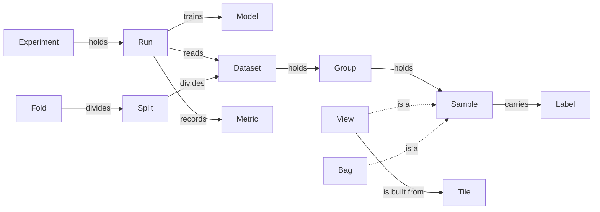

# 📖 Glossary

[Spec](README.md) / Glossary

The vocabulary of the spec, one meaning per term.
A term defined here keeps that meaning everywhere: in the spec, in the documentation, and later in the code.

## Map

## Terms

### Backbone
The pretrained part of a [model](#model) that turns an input into features, under the part specific to the [task](#task).

### Bag
A set of elements that share one [label](#label) and are read together, as in multiple instance learning.
A bag is a kind of [sample](#sample).

### Dataset
The [samples](#sample) available to a [run](#run), with their labels and [metadata](#metadata).

### Decision threshold
The score above which a prediction counts as positive, turning a probability into a decision.

### Experiment
A set of [runs](#run) compared together.

### Fold
One of the K training and validation divisions of the training [split](#split) in a cross-validation.

### Group
The [samples](#sample) that must stay together, such as those of one patient or one slide.
A [split](#split) never separates them, and a group-level [metric](#metric) scores them as one.
Groups can nest, such as the slides of one patient, and each kind of group is a [level](#level).

### Instance
Two meanings for now, an element of a [bag](#bag) and an object found by instance segmentation, until [Q-03](open-questions.md#q-03) settles them.

### Key behaviour
A behaviour that significantly changes what a [run](#run) does, flagged wherever it is documented ([XC-01](cross-cutting.md#xc-01)).

### Label
What a [sample](#sample) should be predicted as: a class, a value, a mask, or several of them.

### Level
One kind of [group](#group) in a nesting, such as the slide or the patient.

### Metadata
What travels with a [sample](#sample) without being fed to the [model](#model), such as its name, its [group](#group) or its position.

### Metric
A number that scores predictions against [labels](#label), over a set of [samples](#sample) or per [group](#group).

### Model
What maps a [sample](#sample) to a prediction for a [task](#task).

### Out-of-fold score
The score a [sample](#sample) receives from the [fold](#fold) model that did not train on it.

### Project
A user's application of StoupyNet: its data, its settings and the [models](#model) it trains, such as the several models of one clinical study.

### Run
One execution with a given configuration, and everything it records: [metrics](#metric), plots, checkpoints.

### Sample
One item a [model](#model) reads at a time, such as an image, a [view](#view) or a [bag](#bag), with its [label](#label) and its [metadata](#metadata).

### Split
The division of a [dataset](#dataset) into training, validation and test parts.

### Task
What a [model](#model) predicts from a [sample](#sample), such as a class, a value or a segmentation.

### Tile
A fixed-size crop of a large image, as stored on disk.

### Trial
One configuration tried by a hyperparameter search.

### View
What a [model](#model) sees of a large image: [tiles](#tile) assembled or cut to a chosen scale.

